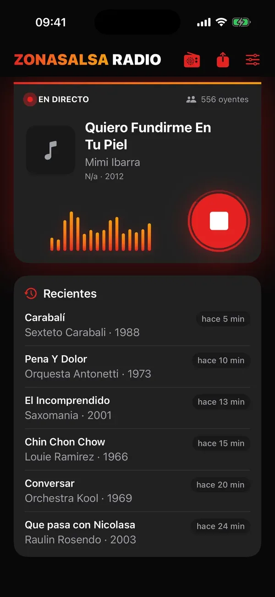
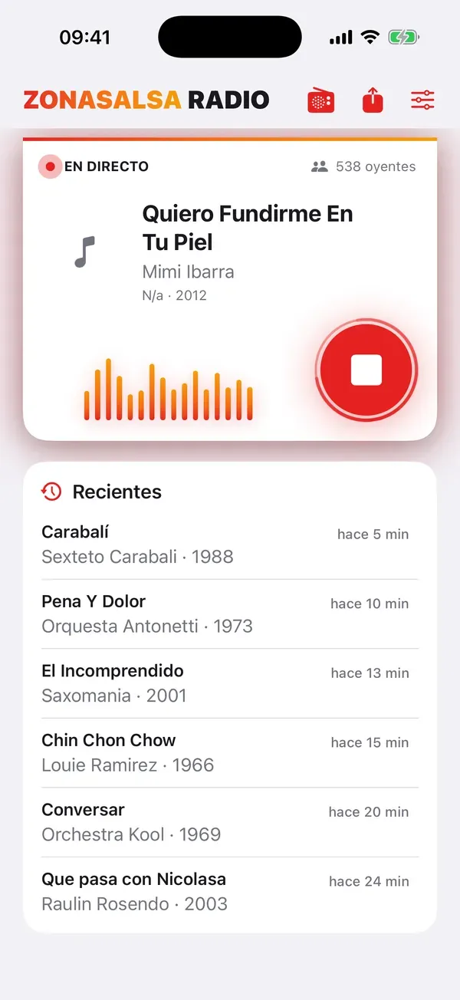
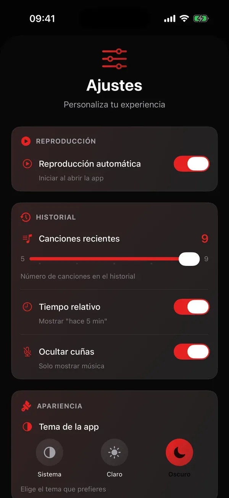
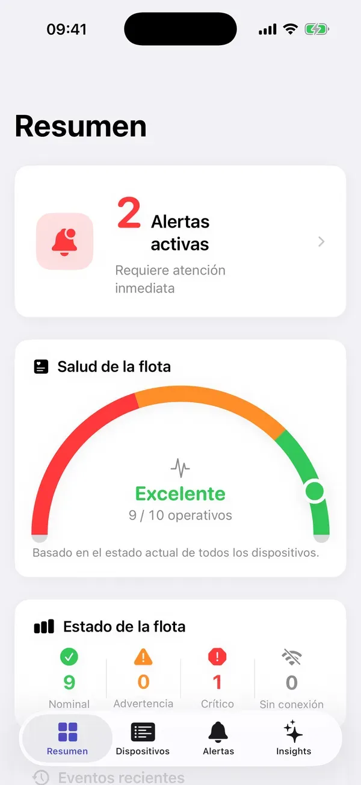
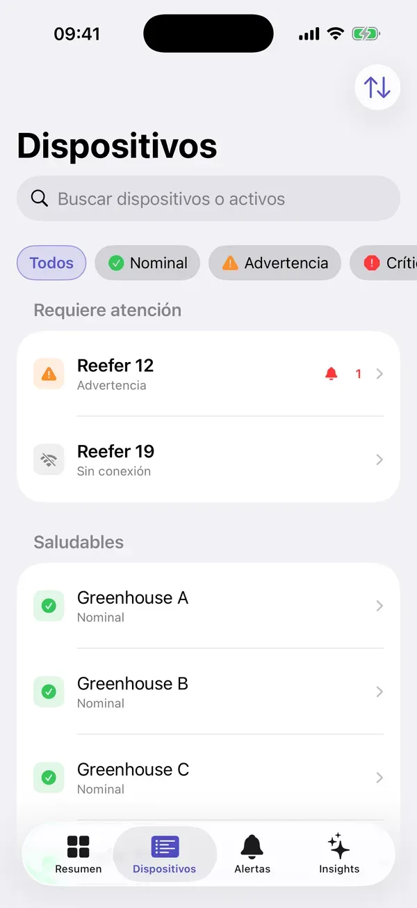
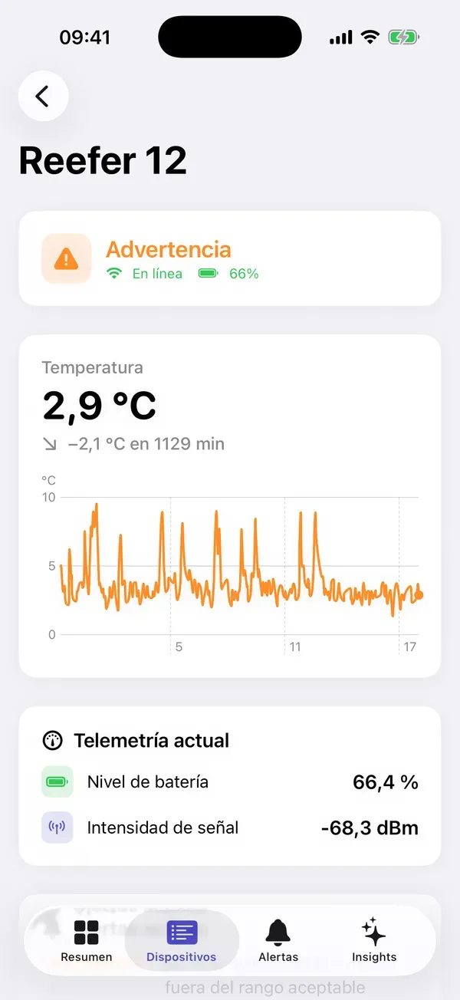
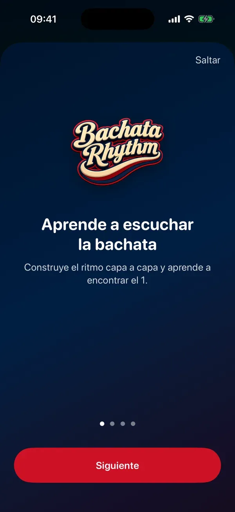
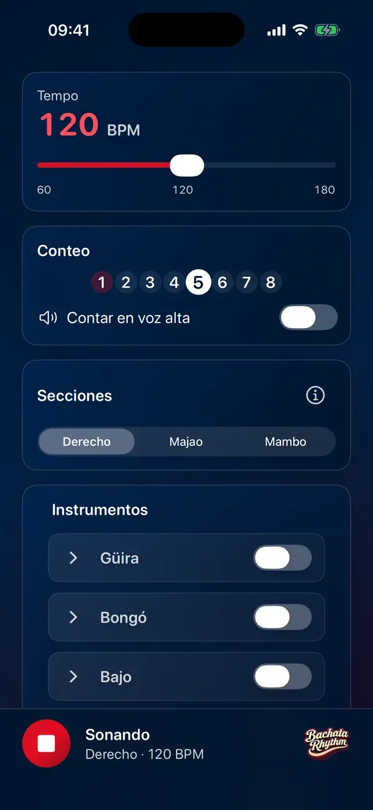
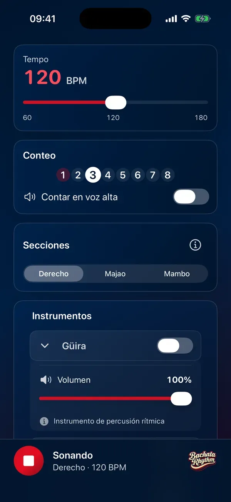

  

<h3 align="center">iOS Developer · Swift · SwiftUI · Swift Concurrency · Clean Architecture</h3>

  
  
  
  
  
  
  
  
  

Hi, I'm Donato. I build native apps for Apple platforms in Swift and SwiftUI, and what I enjoy most is how they're put together: concurrency, module boundaries, tests and the trade-offs behind each decision.

Before my own apps: 3+ years at NTT DATA shipping production iOS apps for the Government of Andalusia, Ferrovial, PRISA (Los40), Renfe and Vodafone.

  <a href="https://www.donatogomez.dev">Website</a> •
  <a href="https://www.linkedin.com/in/donatogomez/">LinkedIn</a> •
  <a href="https://medium.com/@donatogomez">Medium</a>

## 🔭 Right now

- Maintaining **ZonaSalsa**, live on the App Store and Google Play.
- Just released **[OnAir](https://github.com/donatogomez/OnAir)** `0.1.0`, my first open-source Swift package.
- Building **audio-inspector**, a forensic audio-analysis tool for macOS.

## 🛠️ Things I've built

### 🎵 ZonaSalsa

The official app of a 24/7 salsa radio station. I designed, built and shipped it on my own, and I maintain it: iOS first, then an Android version (Kotlin, Jetpack Compose, Media3).

  
  
  

  
  &nbsp;
  

The interesting bits:

- **Playback doesn't live in a view.** A long-lived `@MainActor @Observable` coordinator owns the audio transport, metadata, history and artwork, so "Hey Siri, play ZonaSalsa" or CarPlay works even when no UI exists. The ViewModel is just a facade over it.
- **The audio player is an actor** that reports `connecting` / `playing` / `reconnecting` / `failed` through an `AsyncStream`; every system framework sits behind a protocol in a `Platform` layer.
- **Now playing polls the server's played-tracks endpoint every 15 s** instead of reading ICY metadata from the stream: clean fields and song history, at the cost of up to 15 s of lag.
- Swift 6 language mode with `MainActor` default isolation, ~300 Swift Testing tests, Lock Screen, Control Center and sharing to Stories.

### 📻 [OnAir](https://github.com/donatogomez/OnAir)

A Swift package that plays a live audio stream and keeps it alive, extracted from ZonaSalsa's player with everything station-specific removed.

- **One actor, one state stream.** `RadioPlayer` exposes `play` / `stop` and an `AsyncStream` of states (`connecting`, `playing`, `reconnecting(attempt:)`, `waitingForNetwork`, `interrupted`, `failed`) that any number of subscribers can follow.
- **Reconnection that respects the network**: exponential backoff, no retries burned while offline, and it yields to phone calls and Siri.
- **Tested without audio or network.** `AVPlayer`, `NWPathMonitor` and `AVAudioSession` sit behind protocols; 28 deterministic Swift Testing tests with a manual clock and no `sleep`.
- Swift 6, no third-party dependencies, iOS 17+ and macOS 14+, MIT.

### 📡 [SignalFlow](https://github.com/donatogomez/signal-flow)

Offline-first IoT fleet monitor for iOS 26 and watchOS, with simulated sensors and no backend. Clean Architecture across ~23 SPM modules, SwiftData, on-device Foundation Models, widgets, a Live Activity and an Apple Watch app.

  
  
  

- **Module boundaries are enforced twice**: in the SPM graph and in a CI script, because in a full `swift build` an undeclared `import` can slip through locally.
- **No `@Query` in views.** `@Model` objects never leave a `@ModelActor`; views read `Sendable` domain types through repositories.
- **Facts in Swift, words in the model.** Statistics are computed in Swift and Foundation Models only writes the summary, with `@Generable` output and a deterministic fallback when the model isn't available.
- **Deterministic concurrency tests**: seeded simulator, injected clock and a one-shot readiness signal instead of `sleep`. ~285 Swift Testing tests, gated by GitHub Actions.

### 🎛️ [audio-inspector](https://github.com/donatogomez/audio-inspector)

A macOS tool that analyzes the decoded signal of an audio file, not its tags, to explain what can actually be proven about its source and quality. It separates measurable facts, detected indicators and cautious inferences, each with a confidence level, and never just says "fake MP3". Modular SPM package, 19 ADRs, OpenSpec specs and ~1,900 tests.

### 🧠 Quizly

Imports quizzes from JSON and Markdown and runs them offline in reproducible sessions. Strict layered architecture with unidirectional dependencies, zero third-party dependencies, actor-based file I/O, schema migrations and a deterministic session engine. In progress, headed for the App Store.

### 🥁 Bachata Rhythm

Rhythm trainer for bachata: six tracks (güira, bongó, bass, two guitars and a counting voice) across the derecho, majao and mambo sections, with tempo control, an AVFoundation audio engine, VoiceOver support and a Spanish/English UI. Finished, not yet published.

  
  
  

## ⚙️ How I build

- **Spec-driven, AI-assisted development** with OpenSpec and ADRs. I own the architecture and module boundaries, validate the specs and review every change before merging.
- **The compiler as a safety net**: Swift 6 strict concurrency and warnings as errors.
- **Nothing is done until tests and CI are green.**

## ✍️ Writing

I write about modern Swift on [Medium](https://medium.com/@donatogomez):

- [Reactive Swift Without Combine or Rx](https://medium.com/@donatogomez/reactive-swift-without-combine-or-rx-a35a5ba31e08) · demo: [ReactiveSwift6Demo](https://github.com/donatogomez/ReactiveSwift6Demo)
- [Understanding @MainActor in SwiftUI: A Practical Guide for Swift 6](https://medium.com/@donatogomez/understanding-mainactor-in-swiftui-a-practical-guide-for-swift-6-69e657872ec5) · demo: [MainActorCounter](https://github.com/donatogomez/MainActorCounter)
- [Swift Is Not Just iOS — And Never Was](https://medium.com/@donatogomez/swift-beyond-the-apple-ecosystem-an-underused-language-b5f712ca0c90)

## 🧰 Stack

Swift · SwiftUI · Swift Concurrency (async/await, actors, Sendable) · MVVM · Clean Architecture · Swift Package Manager · URLSession / REST · SwiftData · Swift Testing · XCTest · GitHub Actions · AVFoundation · CarPlay · App Intents · WidgetKit · watchOS · TestFlight
